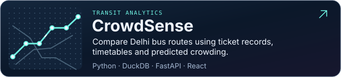
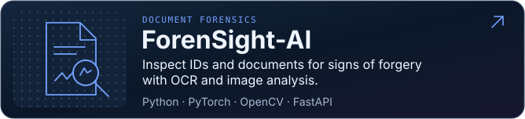
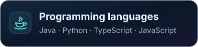
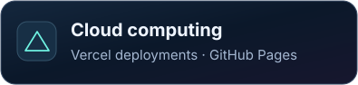
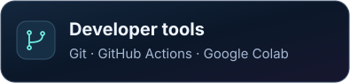
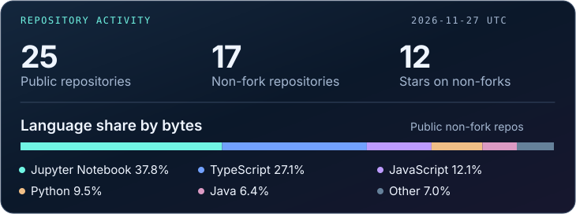
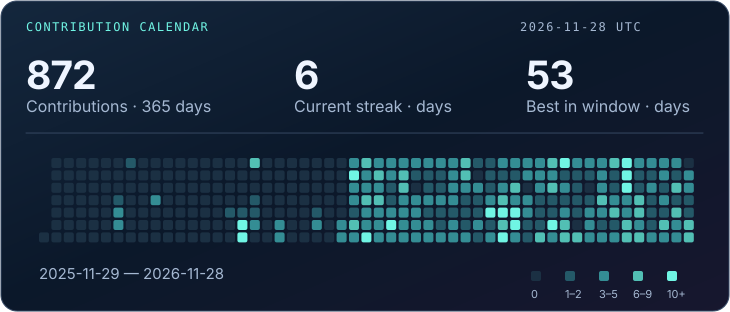
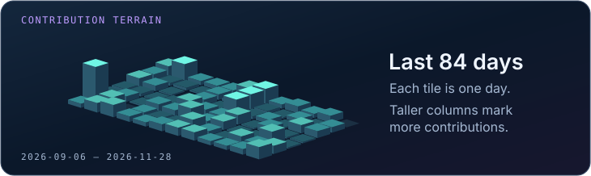

  <picture><source media="(max-width: 540px)" srcset="assets/banners/hero-mobile.svg" /></picture>

I’m Devansh, a computer science student at GLA University. I build tools that turn data into decisions, from choosing a less crowded bus in Delhi to spotting a suspicious detail in a document. I also solve data structures and algorithms problems in Java.

[Selected projects](#selected-projects) · [Technical skills](#technical-skills) · [GitHub activity](#github-activity) · [Contact](#contact)

## About me

<picture><source media="(max-width: 540px)" srcset="assets/animations/terminal-mobile.svg" /></picture>

I’m open to collaborating on machine learning projects and hackathon builds. I contributed to GirlScript Summer of Code, completed Andrew Ng’s Machine Learning Specialization, and placed fourth with Team ForesightAI at the INTRUSIONX Cybersecurity Hackathon.

## Selected projects

<a href="https://github.com/devansh-g10/CrowdSense"><picture><source media="(max-width: 540px)" srcset="assets/projects/crowdsense-mobile.svg" /></picture></a>

<a href="https://github.com/devansh-g10/Smart-Attendence"><picture><source media="(max-width: 540px)" srcset="assets/projects/attendance-mobile.svg" /></picture></a>

<a href="https://github.com/devansh-g10/ForenSight-AI"><picture><source media="(max-width: 540px)" srcset="assets/projects/forensight-mobile.svg" /></picture></a>

<a href="https://github.com/devansh-g10/code-quest"><picture><source media="(max-width: 540px)" srcset="assets/projects/code-quest-mobile.svg" /></picture></a>

More work includes [machine learning exercises in Python](https://github.com/devansh-g10/deep-ml), [LeetCode solutions in Java](https://github.com/devansh-g10/Leetcode-Problem-Solution-), and [my CropShield AI fork](https://github.com/devansh-g10/CropShield-AI) for diagnosing crop disease from leaf images.

## Technical skills

  
  
  
  
  
  
  
  

## GitHub activity

<picture><source media="(max-width: 540px)" srcset="assets/stats/repositories-mobile.svg" /></picture>

<picture><source media="(max-width: 540px)" srcset="assets/stats/contributions-mobile.svg" /></picture>

Explore the last 12 weeks in 3D

## Contact

  
  
  
  

